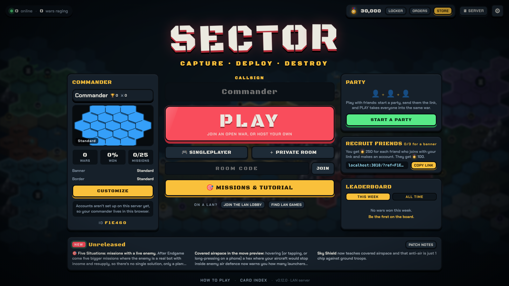
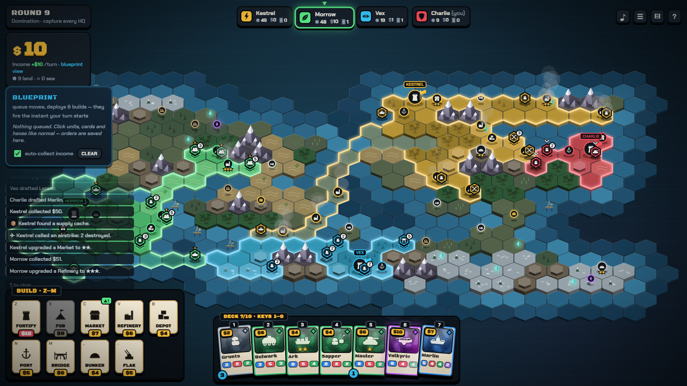
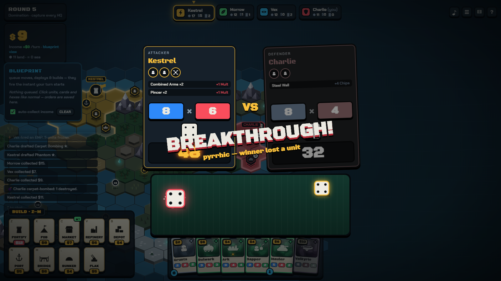
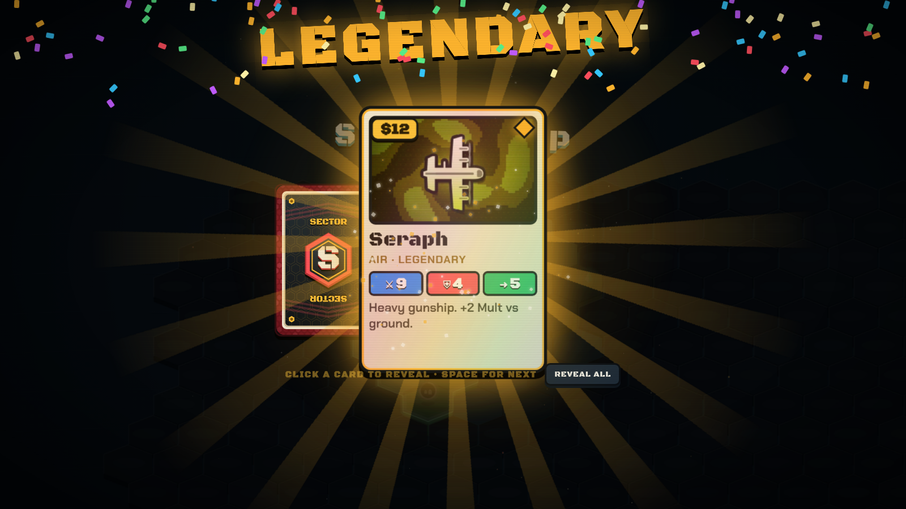
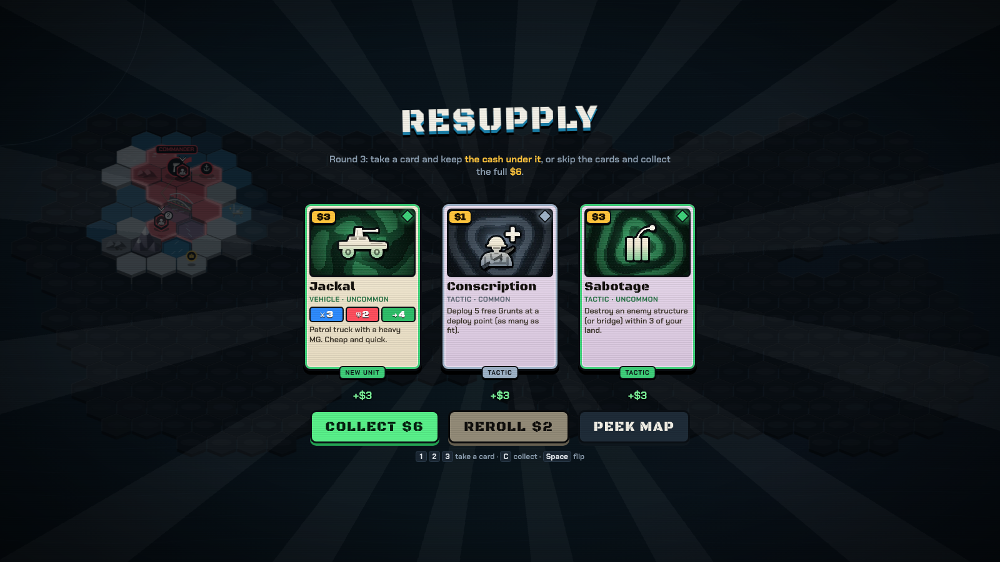
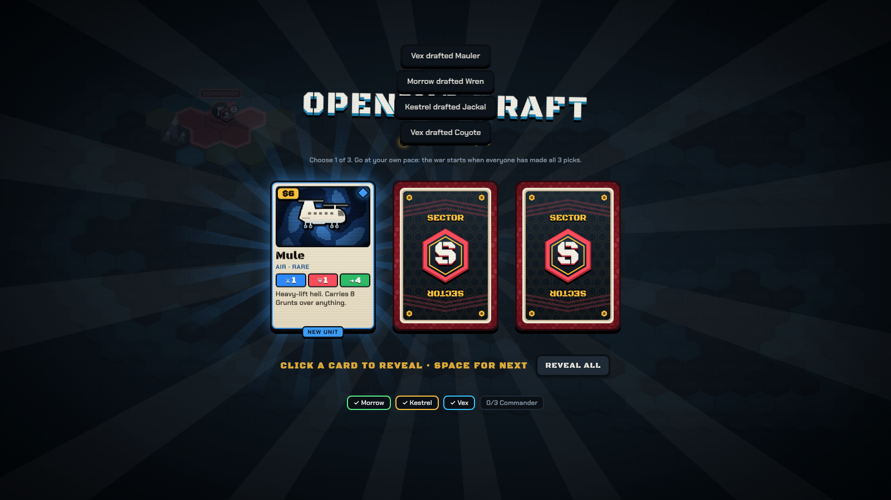
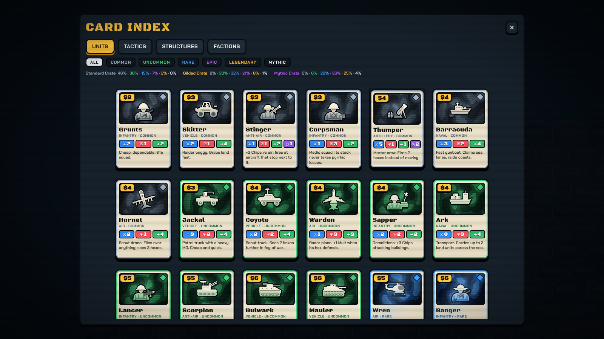
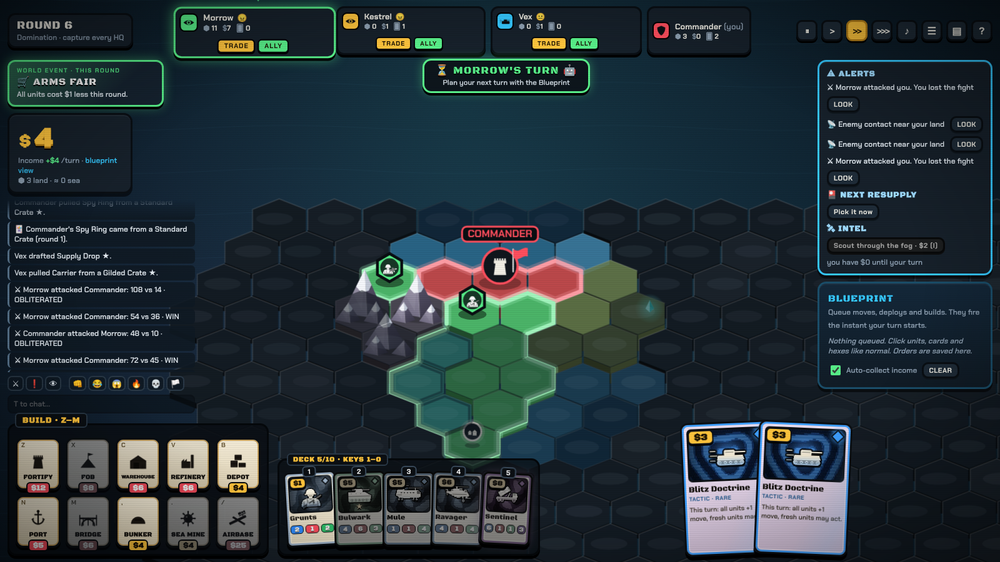
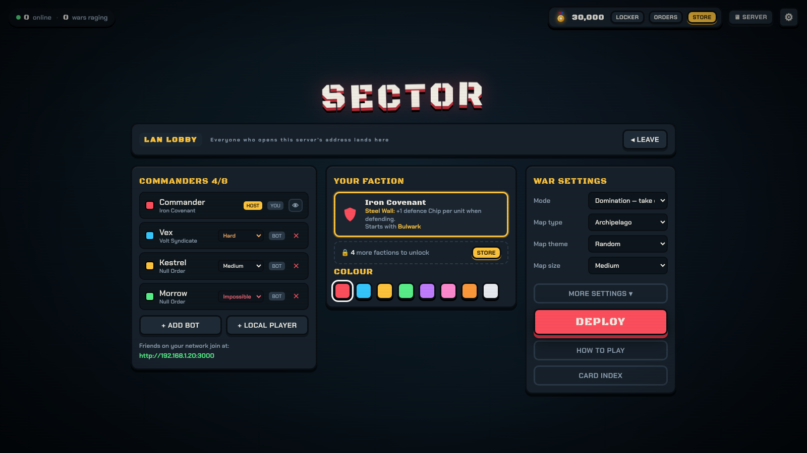

<div align="center">



# SECTOR

**Capture · Deploy · Destroy**

A turn-based hex conquest game for 2–6 players on the same Wi-Fi.<br>
Procedural maps · card drafting · naval warfare · Balatro-style dice combat.

[**⬇ Download for Windows**](../../releases/latest) · [How to play](docs/RULES.md) · [Card list](docs/CARDS.md)

</div>

---

## Play in 30 seconds

1. Download **`Sector.exe`** from the [latest release](../../releases/latest).
2. Double-click it. The **SECTOR server window** opens, a live dashboard with your addresses, players and status. Press **O** to open the game in your browser (or go to `http://localhost:3000`).
3. Friends on the **same network** open the **INVITE** address shown in the server window in their browser (for example `http://192.168.1.20:3000`). Press **C** to copy it. On the front menu, press **PLAY** for a quick war, open a **private room** and share its code, or start a **party** so you all go in together. **Join the LAN lobby** is the classic one-lobby game.

**Updates install themselves.** Sector.exe checks this repo's releases, and when there's a new version the server window says so: press **U** to update and restart. Only the host needs the exe: friends who join through a browser always get the host's version.

> The first launch asks for network access. Tick **Private networks** so friends can connect.

**"Windows protected your PC"?** Click **More info → Run anyway**. SECTOR isn't code-signed yet, so SmartScreen doesn't know the publisher; that's normal for small indie downloads. Microsoft Defender scans the exe clean, and updates installed from the server window (**U**) don't trigger the warning again. The release workflow signs the exe automatically once a code-signing certificate is added (see [DEVELOPMENT.md](docs/DEVELOPMENT.md#code-signing)).

There are no accounts, no internet servers and no port forwarding. Prefer one screen? Add **local players** in the lobby for **pass-and-play** on a single device. Short on friends? Add bots on **Easy, Medium, Hard or Impossible**.

---

## What it looks like

<table>
<tr>
<td width="50%"><br><sub><b>Every map is procedurally generated</b> from continents, archipelagos, inland seas and more. Territory pays income, so it's a nonstop land grab.</sub></td>
<td width="50%"><br><sub><b>Chips × Mult combat.</b> Unit stats, terrain, flanking and pincers stack up. Then you fling your own die into the tray.</sub></td>
</tr>
<tr>
<td><br><sub><b>Rarity-based reveals.</b> Commons snap over, Epics fly to centre stage, and Legendaries shake, spin and detonate.</sub></td>
<td><br><sub><b>Resupply every turn.</b> Take a card and keep most of your income, or take the full income. Duplicate units level up ★.</sub></td>
</tr>
<tr>
<td><br><sub><b>Opening draft.</b> Everyone picks 3 cards at the same time before the war starts.</sub></td>
<td><br><sub><b>Card index.</b> Every unit, tactic, structure and faction, plus the crate odds.</sub></td>
</tr>
<tr>
<td><br><sub><b>Readable at a glance.</b> Team-coloured territory, unit stacks, supply lines, sea control and bridges.</sub></td>
<td><br><sub><b>LAN lobby.</b> Pick a faction and colour, add bots or local players, choose the map type and mode.</sub></td>
</tr>
</table>

---

## Features

| | |
|---|---|
| 🗺️ **Procedural maps** | Seven layouts (continent, supercontinent, twin continents, archipelago, inland sea, crescent isles, open ocean), noise-warped so no two outlines match. |
| 🃏 **Cards** | A deck of up to 10 unit cards. Pull a duplicate and it levels up (★ +1 ATK/DEF, max ★★★). Six rarities from Common to Mythic, and every Legendary and Mythic is unique. |
| 🎰 **Supply Drop** | A tactic card in Rare, Epic and Legendary versions. Playing it spins a slot-machine reel for a pack tier, then you tear the foil pack open along its top seam and it lights up in the best card's rarity colour. |
| 🎲 **Combat** | Score = chips × (d6 + mult). Throw the die yourself. Combined Arms, Pincers, Flanking, terrain and structures all stack. |
| ✈️ **Air power and air defence** | Helicopters, gunships and stealth bombers, strikes from Gun Runs to B-52 raids and cruise missiles. Anti-air guards the airspace around it: aircraft that stop inside it draw fire, shown as red shaded airspace while you fly. |
| ⚓ **Navy** | Claim sea lanes and oil rigs, earn shipping-lane income from your Ports, raid treasure islands with Ark transports, and back up land battles with naval gunfire. Build bridges across narrow straits and rivers (they open the turn after you build them). |
| 🏭 **Economy and logistics** | Hexes only pay if they're connected by supply to your HQ, a FOB or a Port. Build Warehouses, Refineries and Depots, and **stack them up to ★★★**. Fortify your HQ. Encircle enemy pockets to annex them. |
| 🌐 **Easy LAN** | A host/join panel scans your Wi-Fi for games. Watch games in progress and **take over a bot** mid-game. The Esc menu lets you leave, and a bot takes over your seat. |
| 🤝 **Diplomacy** | Trade cash and cards with other players. Bots haggle too. |
| 🧠 **Bots** | Four difficulties. Bots draft, build, invade by sea, set up pincers and judge trades. They have moods, hold grudges and ally against whoever is most dangerous. |
| 📋 **Blueprint** | Queue your turn while others play; it runs the moment your turn begins. |
| 🗺️ **Living maps** | Map themes (Grasslands, Woodland, Desert, Badlands, Arctic, Jungle, Wetlands, Highlands or Mixed), rivers you ford or bridge, ruins and caches to loot, villages and forts to conquer, relics to fight over. Tiny to Huge sizes, up to 10 commanders. Random spawns or pick your HQ. |
| 🌫 **Fog, alliances and events** | Optional fog of war, alliances with shared victory (and betrayal), world events like storms and gold rushes, undo, and an end-of-game War Report with battle heatmaps, charts and awards. |
| ⚔️ **Factions** | Iron Covenant, Volt Syndicate, Ashen Nomads, Verdant Host and Null Order, each with a perk and a starting unit. |
| 🎨 **No assets** | Every unit, card and building is procedural vector art, and every sound is synthesized. The whole game is about 300 KB of code. |

## Modes

| Mode | Win by |
|---|---|
| **Domination** | Capturing every enemy HQ. |
| **Conquest** | Holding 60% of the land. |
| **Beacon** | Holding the glowing centre hex for 3 turns in a row. |
| **World War** | Holding 45% of a colossal map with superweapon silos, a war economy and faster turns. |

Any mode can be played in **Teams**.

Full rules are in **[docs/RULES.md](docs/RULES.md)**.

---

## Run from source

You need [Node.js](https://nodejs.org) 22 or newer. There are **no dependencies**, so there's nothing to `npm install`.

```bash
git clone https://github.com/Blacksheep909/sector.git
cd sector
node server.js
```

Then open http://localhost:3000. On Windows you can also double-click `Start Sector.bat`.

## Build the .exe

```bash
node tools/build-exe.js
```

This packages the server and the client into a single `dist/Sector.exe` (a Node single-executable application).

Releases are automated. Write the release post in `docs/releases/vX.Y.Z.md` (plus a line in `docs/CHANGELOG.md`), then push the tag. GitHub Actions runs the bot-vs-bot smoke test, builds and (if configured) signs the exe, and publishes a release with that post:

```bash
git tag v1.0.0
git push origin v1.0.0
```

## Project layout

```
server.js            LAN server: HTTP + hand-rolled WebSocket, lobby, bots, pass & play
shared/engine.js     all game rules (authoritative on the server; also used in the browser for previews)
shared/bot.js        AI opponents
public/              the client: render.js (board), main.js (HUD & flow), cards.js (cards, reveals, index),
                     art.js (vector art), audio.js (synth SFX), style.css
tools/               sim.js (headless bot games), maps.js (map previews), build-exe.js, screenshots.js, make-icon.js, e2e-pass.js, e2e-blueprint.js, e2e-spawn.js, balance.js
docs/                rules, card reference, development notes, screenshots
```

See **[docs/DEVELOPMENT.md](docs/DEVELOPMENT.md)** for the architecture and the testing tools, and **[docs/HOSTING.md](docs/HOSTING.md)** to put a server online.

---

## Licence

SECTOR is © 2026 Charlie Frater and licensed under the [PolyForm Noncommercial License 1.0.0](LICENSE): free to play, share and modify for any noncommercial purpose. Commercial use needs written permission.

<sub>SECTOR began as a cardboard board game made in Year 10, with hand-built models and a lot of dice. This is the remake.</sub>
